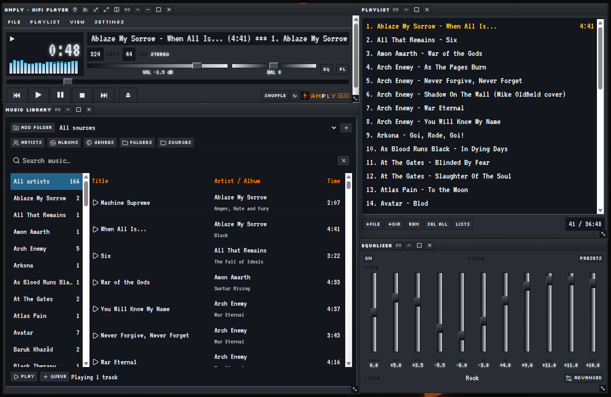
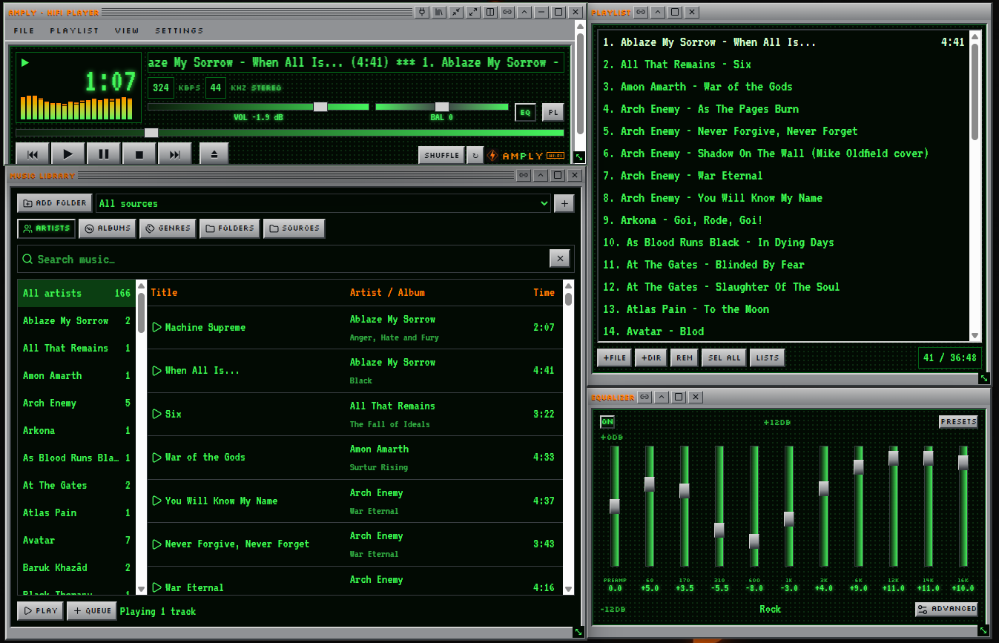
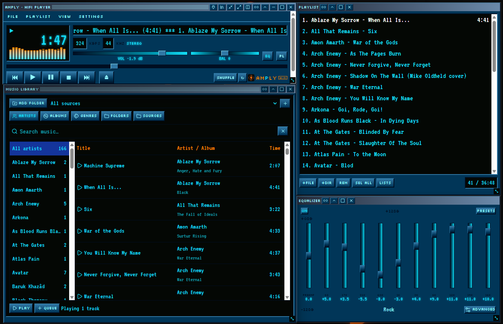
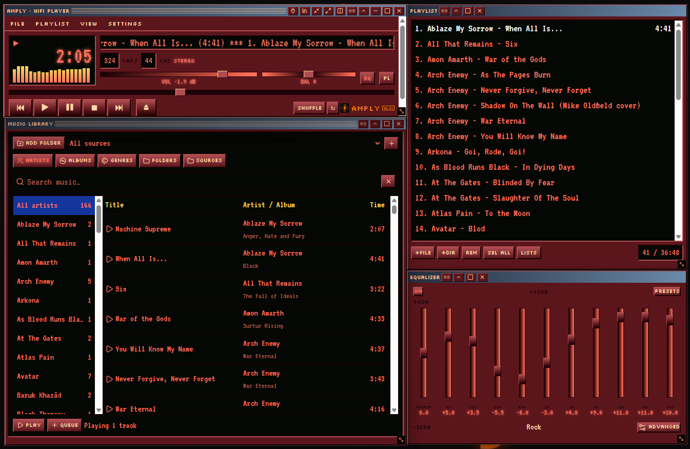
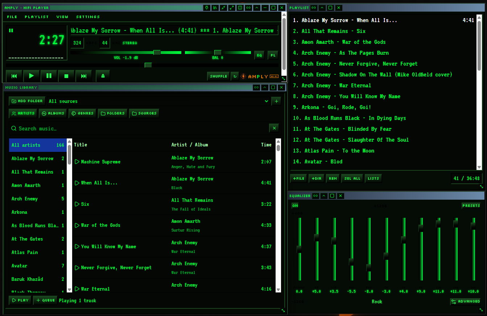

<p align="center">
  
</p>

# AmPly — Amplified Hi-Fi Player

> A reverse-engineered tribute to the classic Winamp 2 — *because it really whipped the Llama's ass.*

AmPly is a Win95-styled, sharp-edged audiophile music player with modern functions. It runs in the browser and as a native desktop app for Windows and Debian-based Linux, where every panel (player, playlist, equalizer, library) is its own real window. The Debian package is available for testing on 64-bit Intel / AMD computers; ARM devices are not supported by this package.

**Website:** [amply.win](https://amply.win) · **Downloads:** [GitHub Releases](https://github.com/ChrilleMalmberg/amply-amplified-hi-fi-player/releases)

## Screenshots

| Modern | Matrix Grid (default) |
|---|---|
|  |  |

| Nucleo | Ruby | Matrix |
|---|---|---|
|  |  |  |

## Features

- **Bit-perfect playback path** — source → preamp → 10-band EQ → balance → output. Visualizers only listen; they never alter the sound.
- **10-band equalizer** with presets, live dB readouts, and Advanced EQ (precise values, headroom suggestion, flat reset).
- **Music library** — add folders, auto-sorted by artists, albums, genres, folders and sources using file tags.
- **Playlists** saved and restored between sessions, fully offline.
- **Skins** — Silver, Classic, Nucleo, Ruby, Matrix and Modern (right-click a title bar or View → Skins).
- **Snapping windows** — panels docked to the player move, resize and maximize together; detach any panel to use it alone, even on another monitor.
- **Menu bar** — File, Playlist, View and Settings menus.
- **Neon startup sequence** with progress bar and original startup sound.

## Windows app

Download [the Windows installer](https://github.com/ChrilleMalmberg/amply-amplified-hi-fi-player/releases/latest/download/AmPly-V3.1.exe) and run it. It is unsigned, so Windows SmartScreen may warn: click **More info → Run anyway** only if you downloaded the installer from this project's release.

Build it yourself:

```sh
bun install
bun run package:win
```

## Debian / Linux app

Download [`amply_3.0.0_amd64.deb`](https://github.com/ChrilleMalmberg/amply-amplified-hi-fi-player/releases/download/v3.0/amply_3.0.0_amd64.deb) from the **v3.0 release**. This link works once the Debian file has been attached to that release.

1. Save the file in **Downloads**, or copy it from your USB stick into Downloads.
2. Double-click the `.deb` file and choose **Install** if your desktop offers a software installer.
3. Alternatively, open Downloads in your file manager, right-click an empty space, and choose **Open in Terminal**. Run:

   ```sh
   sudo apt install ./amply_3.0.0_amd64.deb
   ```

   Enter your account password (no characters appear as you type), then confirm if asked. An internet connection may be needed to install missing system packages.
4. Open **AmPly HiFi Player** from the applications menu, or run `amply` in a terminal. Do not launch the player with `sudo`.
5. Press **Power on** or **Skip**, then drag music into Playlist or choose your music folder in Library. Your original files are not moved; imported music and saved playlists work offline.

For USB transfer, download the Debian file on another computer and copy it over. The installer travels offline, but missing system packages may still need internet access on the Debian computer.

For troubleshooting, updates and removal, see the [Linux setup guide](docs/linux-setup.md). The Linux package still needs user testing on a physical Debian desktop; compatibility with every Debian-based distribution is not verified.

Build the Linux Electron app yourself:

```sh
bun install
bun run package:linux
```

This command stages the Linux application under `/tmp/amply-v3.0-release`; it does not automatically assemble a Debian installer.

## Development

```sh
bun install
bun run dev
bunx vitest run
```

## Built with

TanStack Start · React · TypeScript · Tailwind CSS · Web Audio API · Electron

## Disclaimer

AmPly is an independent project, not affiliated with Winamp or Nullsoft. Names mentioned belong to their respective owners.
